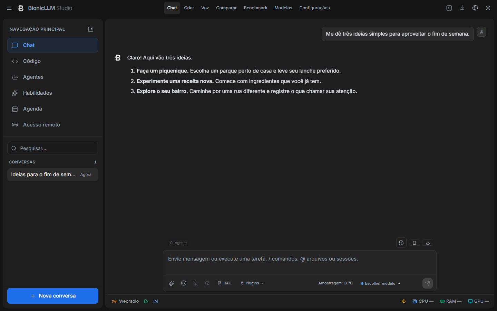
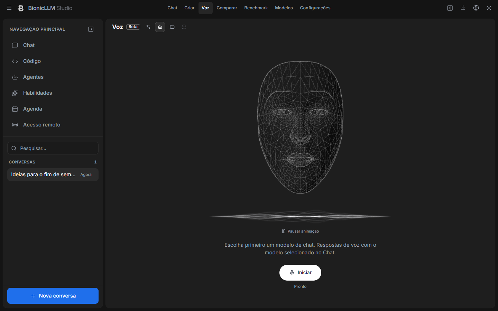

# BionicLLM Studio

Estúdio desktop de IA para conversar com modelos locais ou na nuvem, usar agentes, trabalhar com código e gerar imagens e vídeos.

[Baixar o instalador para Windows x64](https://github.com/ronnepereira/BionicLLM-Studio/releases/latest). O aplicativo verifica novas versões pelo GitHub e pede confirmação antes de instalar.

O repositório também contém o código para Linux e macOS, plataformas experimentais nesta distribuição.

## Como usar os modelos

Um modelo é a IA que responde às suas mensagens ou gera conteúdo. Para começar, escolha como quer usar:

- **No seu computador.** Vá em **Modelos → Obter novo** para baixar um modelo. Se você já tiver um arquivo **GGUF**, abra-o em **Modelos → Arquivo GGUF**. O app também pode se conectar ao Ollama ou LM Studio. Depois de baixar um modelo local, você pode conversar sem internet. O desempenho depende do seu computador.
- **Pela internet.** Vá em **Configurações → Provedores** para conectar um serviço de IA. Alguns serviços pedem uma chave de acesso ou cobram pelo uso.

O BionicLLM Studio também aceita modelos **sem censura** (*uncensored*). Os filtros de conteúdo dependem do modelo e, se você usar um serviço pela internet, das regras desse serviço.

No **Chat**, clique em **Escolher modelo** ao lado da caixa de mensagem. Você pode trocar de modelo quando precisar.

| Onde | O que você pode fazer |
| --- | --- |
| **Chat** | Fazer perguntas, escrever textos e enviar imagens para modelos que conseguem analisá-las. |
| **Código e Agentes** | Pedir ajuda para escrever e revisar código ou executar tarefas com as ferramentas que você autorizar. |
| **Voz** | Falar pelo microfone e ouvir as respostas do modelo escolhido no Chat. |
| **Comparar** | Fazer a mesma pergunta a modelos diferentes e olhar as respostas lado a lado. |
| **Benchmark** | Medir a velocidade dos modelos locais no seu computador. |
| **Criar** | Gerar ou editar imagens, criar vídeos e gerar música. Escolha um modelo para o tipo de conteúdo que quer criar. As opções dependem dos modelos e serviços configurados. |

## Telas do aplicativo

Capturas da interface em português com uma conversa de demonstração.

### Tela principal



### Voz



### Criar


## Desenvolvimento

Requer Node.js 22+, Rust e os pré-requisitos do Tauri 2.

```sh
npm ci
npm run dev
npm run tauri dev
```

Veja [como contribuir](CONTRIBUTING.md), [como preparar uma versão](docs/PUBLICACAO-GITHUB.md) e [como reportar uma vulnerabilidade](SECURITY.md).

## Licença e créditos

[AGPL-3.0-only](LICENSE). Consulte [os créditos de origem](third-party/UPSTREAM-NOTICE.md) e os [avisos de componentes de terceiros](third-party/).


## Apoie o desenvolvimento

Gostou do BionicLLM Studio? Apoie o desenvolvimento pagando um café.

[](https://www.paypal.com/donate/?business=ronne.pereira%40gmail.com&item_name=Apoio%20ao%20BionicLLM%20Studio&currency_code=BRL)
