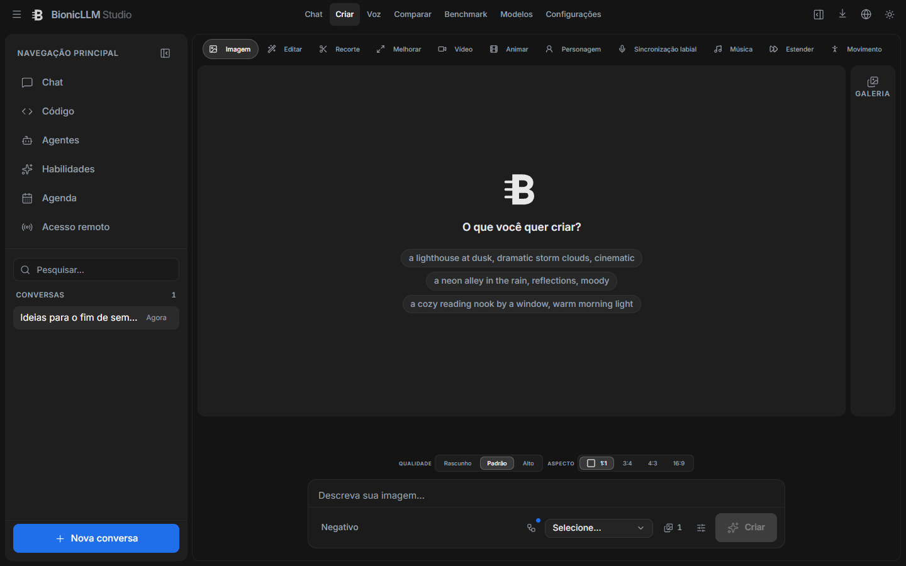

# BionicLLM Studio

Estúdio desktop de IA para conversar com modelos locais ou na nuvem, usar agentes, trabalhar com código e gerar imagens e vídeos.

[Baixar o instalador para Windows x64](https://github.com/ronnepereira/BionicLLM-Studio/releases/latest). O aplicativo verifica novas versões pelo GitHub e pede confirmação antes de instalar.

O repositório também contém o código para Linux e macOS, plataformas experimentais nesta distribuição.

## Como usar os modelos

Um modelo é a IA que responde às suas mensagens ou gera conteúdo. Para começar, escolha como quer usar:

- **No seu computador.** Vá em **Modelos → Obter novo** para baixar um modelo. Se você já tiver um arquivo **GGUF**, abra-o em **Modelos → Arquivo GGUF**. O app também pode se conectar ao Ollama ou LM Studio. Depois de baixar um modelo local, você pode conversar sem internet. O desempenho depende do seu computador.
- **Pela internet.** Vá em **Configurações → Provedores** para conectar um serviço de IA. Alguns serviços pedem uma chave de acesso ou cobram pelo uso.

O BionicLLM Studio também aceita modelos **sem censura** (*uncensored*). Os filtros de conteúdo dependem do modelo e, se você usar um serviço pela internet, das regras desse serviço.

No **Chat**, clique em **Escolher modelo** ao lado da caixa de mensagem. Você pode trocar de modelo quando precisar.

| Onde | O que você pode fazer |
| --- | --- |
| **Chat** | Fazer perguntas, escrever textos e enviar imagens para modelos que conseguem analisá-las. |
| **Código e Agentes** | Pedir ajuda para escrever e revisar código ou executar tarefas com as ferramentas que você autorizar. |
| **Voz** | Falar pelo microfone e ouvir as respostas do modelo escolhido no Chat. |
| **Comparar** | Fazer a mesma pergunta a modelos diferentes e olhar as respostas lado a lado. |
| **Benchmark** | Medir a velocidade dos modelos locais no seu computador. |
| **Criar** | Gerar ou editar imagens, criar vídeos e gerar música. Escolha um modelo para o tipo de conteúdo que quer criar. As opções dependem dos modelos e serviços configurados. |

## Ferramentas e recursos

### Aparência e personalização

- **Tema claro ou escuro.** Troque o visual do app pelo ícone no topo ou em **Configurações → Aparência**.
- **Fundo do chat com imagem ou vídeo.** Use um arquivo do computador ou um link direto. Ajuste o escurecimento para manter o texto legível.
- **Interface do seu jeito.** Mude o idioma, o tamanho da interface, a cor dos botões e a sua foto de perfil. Abra ou recolha as barras laterais e redimensione o painel da direita.

### Chat, arquivos e voz

- **Conversas organizadas.** Busque no histórico, renomeie ou duplique uma conversa. Edite uma mensagem, peça outra resposta ou abra uma nova conversa a partir daquela mensagem.
- **Fila de mensagens.** Envie outro pedido enquanto a IA ainda responde. A mensagem fica na fila e segue automaticamente quando chegar a vez dela, tanto no Chat quanto no Código.
- **Respostas formatadas.** Leia listas, tabelas, blocos de código, fórmulas em LaTeX e amostras de cores ao lado dos códigos. O chat também tem seletor de emojis.
- **Imagens e documentos.** Anexe imagens para modelos com visão. Adicione documentos como referência para fazer perguntas sobre o conteúdo deles.
- **Memória e personas.** Configure como o assistente fala e quais informações ele pode lembrar entre conversas. Em conversas longas, o app pode resumir as partes antigas para abrir espaço no contexto do modelo.
- **Voz e leitura em voz alta.** Converse pelo microfone na tela com avatar holográfico ou mande ler uma resposta escrita. Há opções de microfone, voz e velocidade de leitura.

### Navegador, terminal e arquivos

O botão **Painel lateral**, ao lado das transferências, abre estas ferramentas:

| Ferramenta | Para que serve |
| --- | --- |
| **Navegador interno** | Abra sites em várias abas e visualize páginas HTML criadas no seu projeto sem sair do app. |
| **Revisão** | Veja o que mudou nos arquivos do projeto antes de aplicar as alterações propostas. |
| **Terminal** | Abra uma sessão de terminal dentro do app para trabalhar na pasta do projeto. |
| **Abrir arquivo** | Navegue pelas pastas do projeto e veja arquivos. Selecione um ou vários itens para enviar à Lixeira. |

### Agentes, habilidades e tarefas

- **Modo Código.** Trabalhe na pasta do seu projeto. Peça para o modelo planejar, sugerir mudanças, revisar arquivos ou executar comandos com as permissões que você definir.
- **Agentes e subagentes.** Salve perfis com instruções e modelos diferentes. Divida uma tarefa em partes, como escrever o código e depois revisar, quando o modelo oferecer suporte a ferramentas.
- **Agenda e notificações.** Programe tarefas únicas ou recorrentes, acompanhe o histórico e receba o resultado no chat, em uma janela ou em arquivo TXT. As tarefas continuam enquanto o app estiver aberto ou na bandeja.
- **Habilidades, pesquisa e MCP.** Adicione instruções reutilizáveis, pesquise na web e conecte ferramentas externas ao assistente por MCP. Escolha quais ferramentas ele pode usar e quais precisam da sua aprovação.
- **Plugins no Chat e no Código.** Conecte um projeto Remotion já instalado para abrir a prévia e exportar vídeos ou imagens. O REA oferece ferramentas para inspecionar aplicativos e arquivos binários.

### Criação de conteúdo

- **Imagem.** Gere a partir de uma descrição, edite imagens existentes, faça recortes e melhore a resolução.
- **Vídeo e áudio.** Crie vídeos, anime imagens, estenda clipes, gere música ou use ferramentas de personagem, movimento e sincronização labial.
- **Galeria e fluxos do ComfyUI.** Veja o que você criou e importe fluxos do ComfyUI para usar no app. Algumas opções exigem modelos específicos, componentes adicionais ou um serviço configurado.

### Integrações, acesso e manutenção

- **Mensagens e serviços.** Em **Habilidades → Conectores**, há opções para Telegram, WhatsApp, Gmail, Google Drive, Google Agenda, Facebook Páginas, Instagram profissional, LinkedIn, YouTube e TikTok. Cada conexão tem permissões próprias e as ações disponíveis variam por serviço.
- **Acesso pelo celular.** Emparelhe o celular para acessar o app à distância e escolha o que o aparelho pode fazer. Outros programas podem usar os modelos pelo recurso **API local**.
- **Downloads e desempenho.** Acompanhe transferências, escolha a pasta de modelos e veja o uso de CPU, memória e GPU. Use **Benchmark** para medir a velocidade dos modelos locais.
- **Backups e atualizações.** Importe, exporte e restaure conversas nas configurações. O app avisa quando sai uma versão nova e pede confirmação antes de instalar.
- **Rádio e atalhos.** Ouça rádio online pelo rodapé e abra as ferramentas do painel lateral com atalhos de teclado.

## Telas do aplicativo

Capturas da interface em português com uma conversa de demonstração.

### Tela principal


### Voz


### Criar



## Desenvolvimento

Requer Node.js 22+, Rust e os pré-requisitos do Tauri 2.

```sh
npm ci
npm run dev
npm run tauri dev
```

Veja [como contribuir](CONTRIBUTING.md), [como preparar uma versão](docs/PUBLICACAO-GITHUB.md) e [como reportar uma vulnerabilidade](SECURITY.md).

## Licença e créditos

[AGPL-3.0-only](LICENSE). Consulte [os créditos de origem](third-party/UPSTREAM-NOTICE.md) e os [avisos de componentes de terceiros](third-party/).


## Apoie o desenvolvimento

Gostou do BionicLLM Studio? Apoie o desenvolvimento pagando um café.

[](https://www.paypal.com/donate/?business=ronne.pereira%40gmail.com&item_name=Apoio%20ao%20BionicLLM%20Studio&currency_code=BRL)
